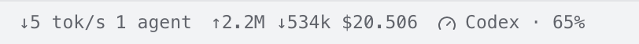
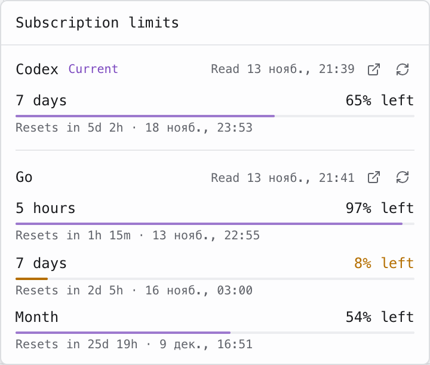

# Ultimate Limits

Subscription limits for the current Ultimate project, with the current conversation's allowance in the bottom bar.

Personal extension in a standalone repository, linked as `~/.ultimate/extensions/limits`. Package: `ultimate-limits`; extension/action id: `limits`. It uses Ultimate's SDK and existing provider authentication, with no dependencies to install.

## Display and project scope

The collapsed chip follows the shown conversation's provider and shows the remaining percentage of the shortest shared window that provider reports: the five-hour window when there is one, otherwise the weekly one, otherwise the monthly one. It reads `Go · 100%` or `Codex · 68%`; the window it belongs to is named in the popup. There is no chip preference to choose. A provider-reported or observed exhausted window always remains visible as `limit reached`, even when the selected five-hour allowance is larger.

The popup lists all subscriptions **used by this project**, with the current provider first and quietly marked Current. Each has independent windows, resets, freshness, dashboard and refresh controls. A slow or failed provider does not hold up another row. The bar uses its existing 12px slot gap, without extra separators or margins.

Project scope comes from the native `models/families` action: effective agent/feature pins and referenced families (including the default model), plus the server-read model of the shown conversation. Unused family presets and historical conversations do not opt in providers. This set is intersected with configured subscription metadata (including OpenCode Go's API-key subscription). A globally stored credential or a disabled `claude-code` extension is not a project enablement signal for the separate `anthropic` provider.

The server checks this same scope **before resolving auth** on every quota action. Missing or failed scope reads stop quota/auth reads, rather than falling back to machine-wide logins. There is no cross-project fan-out.

Nothing is stored in the browser: no preference, migration code or quota history.

## Sources

Source research on 2026-11-13:

| Provider       | Read-only source                                                                             | Acceptance                                                                                                    |
| -------------- | -------------------------------------------------------------------------------------------- | ------------------------------------------------------------------------------------------------------------- |
| `openai-codex` | `GET https://chatgpt.com/backend-api/wham/usage`, existing OAuth and its account scope       | Live confirmed, including a weekly-only plan.                                                                 |
| `anthropic`    | `GET https://api.anthropic.com/api/oauth/usage`, existing subscription OAuth and beta header | Parser tested. Not used by the current project's effective models, so no further auth/quota attempts here.    |
| `opencode-go`  | `GET https://opencode.ai/zen/go/v1/usage`, existing API key                                  | Live confirmed: rolling, weekly and monthly meters. This key needed no extra workspace header.                |
| `xai`          | No quota request                                                                             | Grok Build billing is not proven to cover Ultimate's xAI API route; unavailable if selected in project scope. |

These are source-backed endpoints, not a guaranteed stable public API. Custom provider origins and plain API-key Claude/Codex billing are not supported. Quota is an account allowance, not a prediction of remaining requests for a model. Additional model/group limits produce an explicit partial-coverage warning.

## Refresh and safety

The visible page reads only the current provider while collapsed. Other project subscription rows mount and poll only while the popup is open. Polling/focus reads share the server's five-minute credential-scoped quota cache. Manual refresh has a one-minute minimum and honors `Retry-After`. Hidden pages stop polling; concurrent HTTP requests coalesce. Auth-resolution failures also back off. These are conservative local intervals, not provider SLAs.

Authentication and its normal refresh stay inside `host.modelRuntime.getAuth()`. No auth files are read directly. Requests use fixed endpoints, reject redirects, cap responses at 256 KiB and pass a ten-second signal. Raw errors, headers, credentials and response bodies never enter action results, browser state or logs. A shared request may finish after navigation within that bound. Failed HTTP refreshes retain the previous observation and its original timestamp, marked stale. Expired windows wait for a new observation; they never automatically become 100%.

No model probes, local-token estimates, browser cookies, new logins, billing mutations or settings changes.

## Verification

- `node --test test/*.test.ts`: core parser, priority, project-scope/auth boundary, request/cache and error behavior with mocked HTTP. Run directly to avoid package-manager auto-install.
- `node <ultimate-clone>/scripts/check-extension.ts <this-folder>`: type-check against the host SDK without installing or copying anything.
- Use the clone's installed formatter on this folder only.

Preview runs through the existing host and personal extension link.
